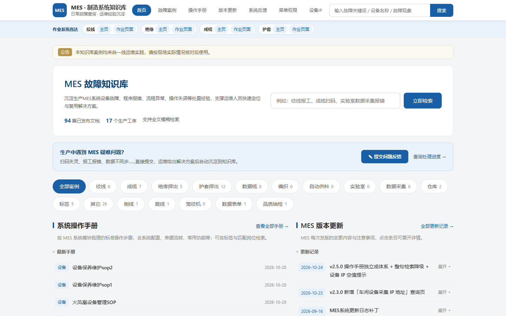
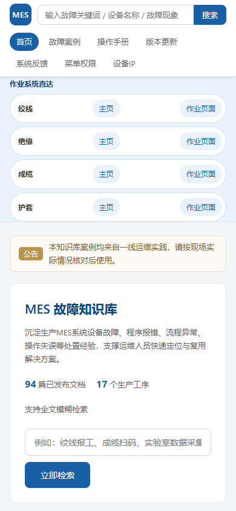
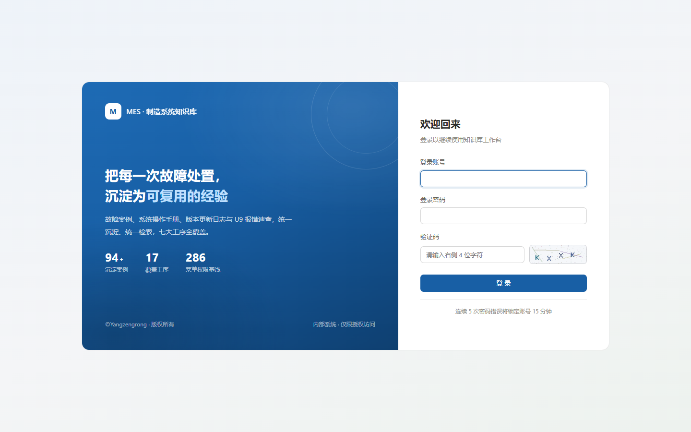
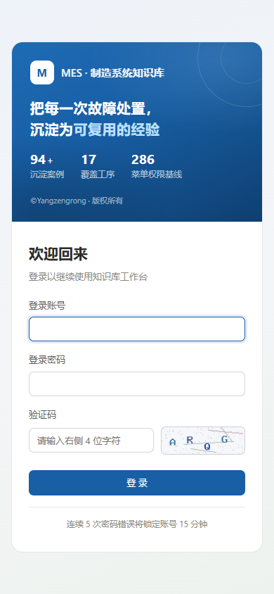

# MES System Knowledge Base

A fault-knowledge management system built for the operation & maintenance of production MES (Manufacturing Execution System) environments. It captures and reuses hard-won experience in handling equipment failures, program errors, process anomalies, and operator mistakes, helping O&M staff quickly search for and apply proven solutions.

- **Architecture**: PHP 7.4 / 8.0 + MySQL 5.7 / 8.0 (native PDO prepared statements, no framework dependency)
- **Frontend**: HTML5 + CSS3 + vanilla JavaScript, no external CDN dependency (intranet-friendly)
- **Server**: Fully compatible with CentOS 7 and Rocky Linux; supports Nginx / Apache
- **Admin entry**: `domain + /admin`, with front/back routing isolation
- **Copyright**: `©Yangzengrong. All rights reserved.` (shown uniformly in the site footer; editable in Admin → System Settings)

---

## Interface Preview

| Home (PC) | Home (Mobile) |
|---|---|
|  |  |

| Admin Login (PC) | Admin Login (Mobile) |
|---|---|
|  |  |

> Screenshots are taken from demo data on the production environment and are for illustration only.

---

## 1. Requirements

| Item | Requirement | Notes |
|---|---|---|
| PHP | >= 7.4 (7.4 / 8.0 recommended) | Requires `pdo`, `pdo_mysql`, `mbstring`, `fileinfo`, `json`, `session` |
| GD extension | Recommended | Used for image CAPTCHA; auto-degrades to SVG CAPTCHA when missing |
| MySQL | 5.7 / 8.0 | Charset `utf8mb4`, engine InnoDB |
| Web server | Nginx 1.20+ or Apache 2.4 | Apache needs `mod_rewrite` and `AllowOverride All` |

The installer automatically detects the environment above and clearly reports any unmet items.

---

## 2. Directory Structure

```
mes-kb/
├─ index.php                  Front entry (routes: home / search / detail / attachment)
├─ admin/                     Admin entry directory (domain + /admin)
│  ├─ _init.php               Admin bootstrap (incl. IP allowlist check)
│  ├─ index.php               Dashboard
│  ├─ login.php / logout.php / captcha.php
│  ├─ cases.php               Case list / recycle bin
│  ├─ case_form.php           Case create / edit form
│  ├─ case_action.php         Unified write-operation entry for cases
│  ├─ categories.php / category_action.php
│  ├─ users.php / user_action.php
│  ├─ attachments.php / attachment_action.php
│  ├─ logs.php / log_export.php
│  └─ settings.php / settings_action.php
├─ app/
│  ├─ bootstrap.php           App bootstrap (autoload / session / config)
│  ├─ Core/                   Core components
│  │  ├─ Config.php           Config container
│  │  ├─ Database.php         PDO wrapper (prepared statements + transactions)
│  │  ├─ Router.php           Minimal router
│  │  ├─ Request.php / View.php
│  │  ├─ Auth.php             Auth & authorization (3-tier roles)
│  │  ├─ Csrf.php             CSRF token
│  │  ├─ Captcha.php          Image CAPTCHA (GD / SVG dual path)
│  │  ├─ Firewall.php         Admin IP allowlist
│  │  ├─ Upload.php           Attachment upload security check
│  │  ├─ Logger.php           Operation / access / search logs
│  │  ├─ Setting.php          System settings read/write
│  │  └─ Validator.php        Form validator
│  ├─ Models/                 User / Category / CaseModel / Attachment / LogModel
│  ├─ Controllers/
│  │  ├─ Front/               HomeController / CaseController / FileController
│  │  └─ Admin/               BaseController + 8 business controllers
│  └─ Support/helpers.php      Global helpers
├─ views/
│  ├─ front/                  Front templates (layout / home / search / case / error)
│  ├─ admin/                  Admin templates (layout / login / dashboard / cases / …)
│  └─ partials/pagination.php  Shared pagination component
├─ static/css|js              Front & admin styles and scripts
├─ storage/
│  ├─ uploads/                Uploaded attachments (grouped by year-month)
│  ├─ backups/                Database backups
│  └─ logs/                   Runtime logs
├─ install/
│  ├─ index.php               Installer wizard (3 steps)
│  └─ schema.sql              Database schema script
├─ config/config.sample.php   Config sample (installer generates config.php)
├─ .htaccess                  Apache rewrite & security config
└─ nginx.conf.sample          Nginx site config sample
```

---

## 3. Installation & Deployment

### 3.1 Upload code and set permissions

```bash
# Assume deployment to /www/wwwroot/mes-kb
cd /www/wwwroot/mes-kb

# Grant write permission to the web user (nginx usually, apache otherwise)
chown -R nginx:nginx storage config
chmod -R 755 storage config
chmod 644 storage/.htaccess app/.htaccess config/.htaccess views/.htaccess
```

### 3.2 Create database (optional; the installer can also create it)

```sql
CREATE DATABASE `mes_kb` DEFAULT CHARACTER SET utf8mb4 COLLATE utf8mb4_general_ci;
CREATE USER 'mes_kb'@'localhost' IDENTIFIED BY 'set_a_strong_password';
GRANT ALL PRIVILEGES ON `mes_kb`.* TO 'mes_kb'@'localhost';
FLUSH PRIVILEGES;
```

### 3.3 Configure the web server

**Nginx**

```bash
cp nginx.conf.sample /etc/nginx/conf.d/mes-kb.conf
vi /etc/nginx/conf.d/mes-kb.conf     # edit server_name / root / fastcgi_pass
nginx -t && systemctl reload nginx
```

**Apache**

```bash
# In httpd.conf: LoadModule rewrite_module modules/mod_rewrite.so
# and allow: <Directory /www/wwwroot/mes-kb> AllowOverride All </Directory>
systemctl restart httpd
```

### 3.4 Run the installer

Visit `http://your-domain/install/index.php` in a browser and finish the 3 steps:

1. **Environment check** — auto-checks PHP version, extensions, directory writability
2. **Database & admin config** — fill in DB connection, site name, super-admin account/password
3. **Done** — auto-writes `config/config.php`, imports schema, initializes settings & default categories

> **Delete the `install` directory immediately after installation** to prevent re-access.

### 3.5 Verify

| URL | Description |
|---|---|
| `http://domain/` | Front home |
| `http://domain/admin` | Admin login (the unified entry required by spec) |

---

## 4. Permission Model

The system uses three-tier roles, centrally defined in the `PERMISSIONS` constant of `app/Core/Auth.php`:

| Role | Scope |
|---|---|
| Super Admin `super_admin` | Full system: account management, case review, status transitions, hard delete, system settings, all logs |
| O&M Admin `op_admin` | Create/edit **own** cases, upload/manage own attachments, view own operation logs; no review or system-settings rights |
| Guest `guest` | Front search, browse, online preview, download only |

Admin menus render dynamically by permission; unauthorized access returns a 403 page, and async requests return 403 JSON.

---

## 5. Case State Machine

```
                    ┌── Approved ──┐
   New ──► Pending ─┤              ├──► Published ──► Offline ──► Offlined
                    └── Rejected ──┘        │              │
                                            │              │
                                  Expired/Manual ──► Expired
                                            │
            Any state ──Delete──► Recycle Bin ──Restore──► Original state
                                            │
                            Hard delete (super admin only, unrecoverable)
```

- Unreviewed (`pending`) cases are invisible on the front end
- Every edit writes a `case_versions` snapshot (editor, change note) for rollback to any historical version
- Attachments are purged from disk when their case is hard-deleted

---

## 6. Requirement Coverage Table

| Requirement | Implementation |
|---|---|
| 2.1 PHP+MySQL architecture | `app/Core/Database.php`, `install/schema.sql` |
| 2.2 Server adaptation | `nginx.conf.sample`, `.htaccess` |
| 2.3 Admin `/admin` entry | `admin/` directory (isolated entry, separated from front routing) |
| 2.4 Copyright convention | `views/front/layout.php`, `views/admin/layout.php`, value sourced from settings |
| 3.1 Modular home | `views/front/home.php` (category blocks / latest / hot / announcements) |
| 3.2 Full-text fuzzy search | `CaseModel::search()` + `views/front/search.php`, matches title, device, error code, phenomenon, cause, solution, prevention |
| 3.3 File upload & management | `app/Core/Upload.php`, `views/admin/case_form.php` |
| 4.1 User permission management | `app/Core/Auth.php`, `admin/users.php`, `Admin/UserController.php` |
| 4.2 Category management | `app/Models/Category.php`, `admin/categories.php` (level 1 / level 2) |
| 4.3 Full case lifecycle | `Admin/CaseController.php`, `admin/cases.php`, `admin/case_form.php` |
| 4.4 Fine-grained attachment management | `app/Core/Upload.php`, `Admin/AttachmentController.php`, `Front/FileController.php` |
| 4.5 Stats dashboard | `Admin/DashboardController.php`, `views/admin/dashboard.php` |
| 4.6 System logging | `app/Core/Logger.php`, `app/Models/LogModel.php`, `admin/logs.php` |
| 4.7 Security hardening | `app/Core/Captcha.php`, `app/Core/Firewall.php`, `app/Core/Csrf.php`, `Auth::attempt()` |
| 4.8 Front-end interaction | `views/front/home.php` (hot ranking / latest), `views/front/case.php` (detail / views / attachments), `static/js/front.js` (search suggest) |
| 4.9 Basic system config | `app/Core/Setting.php`, `admin/settings.php` |
| 5.1 Stability | PDO prepared statements, transactions, index optimization, log fallback |
| 5.2 Compatibility | Responsive layout for Chrome / Edge / Firefox and mobile |
| 5.3 Extensibility | Layered architecture (Core / Models / Controllers / Views); reserved hooks for comments, repairs, likes |
| 5.4 Data backup | `SettingController::backup()` pure-PHP full SQL export, download & delete supported |

---

## 7. Common O&M Operations

### Database backup

In Admin → System Settings → Data Backup, click **Backup now** to generate a `.sql` file under `storage/backups/`, downloadable for safekeeping.

Restore from command line:

```bash
mysql -u mes_kb -p mes_kb < storage/backups/mes_kb_20260910_120000.sql
```

### Log troubleshooting

```bash
tail -f storage/logs/php_error.log      # PHP error log
tail -f storage/logs/fallback.log       # Degraded log when DB is unavailable
tail -f /var/log/nginx/mes-kb.error.log # Web server log
```

### Periodic cleanup

```bash
# Remove backups older than 30 days
find storage/backups -name "*.sql" -mtime +30 -delete

# Remove access-log rows older than 90 days (run in MySQL)
# DELETE FROM access_logs WHERE created_at < DATE_SUB(NOW(), INTERVAL 90 DAY);
```

### Automatic case expiry

The system auto-marks overdue cases as "Expired" when the front end is visited or the admin dashboard is opened. For precise scheduling, add a crontab:

```bash
# Trigger once daily at 00:10 (via the admin dashboard endpoint)
10 0 * * * curl -s -o /dev/null "http://127.0.0.1/admin/index.php"
```

---

## 8. Design Notes & Caveats

**Search performance**: The current fuzzy search is based on `LIKE %keyword%` — simple and compatible. When case volume grows into the tens of thousands and latency appears, enable a MySQL full-text index:

```sql
ALTER TABLE cases ADD FULLTEXT INDEX ft_cases_search
    (title, device, error_code, phenomenon, cause, solution, prevention) WITH PARSER ngram;
```

Then switch `CaseModel::search()` to `MATCH ... AGAINST (... IN BOOLEAN MODE)`.

**Upload security**: Attachment uploads go through triple validation — extension allowlist, size limit, and `finfo` real MIME sniffing. Files whose extension disagrees with content are rejected outright. Attachments are never placed in a web-served directory; they are always output through `Front/FileController` after authorization, preventing unauthorized download.

**Front/back separation**: The front end routes through `index.php` (pretty URL `/case/12`); the back end uses standalone `.php` entries under `admin/`. They share one session but the back end is identified independently via `admin_user_id`, and the front end has no back-end privileges whatsoever.

**About LayUI / Vue**: The spec mentioned "LayUI or Vue lightweight framework". To fit intranet deployment (no external CDN access), this project uses self-built lightweight styles and vanilla JS, keeping a visual style consistent with LayUI. To switch to LayUI, place the framework package under `static/layui/` and include it in `views/admin/layout.php` and `views/front/layout.php` — no back-end logic is affected.

---

## Open Source License

This project is released under the [MIT License](LICENSE), copyright **©Yangzengrong**. You may freely use, modify, and redistribute it under the MIT terms; derivative works must retain the copyright and license notices.

©Yangzengrong All rights reserved.
