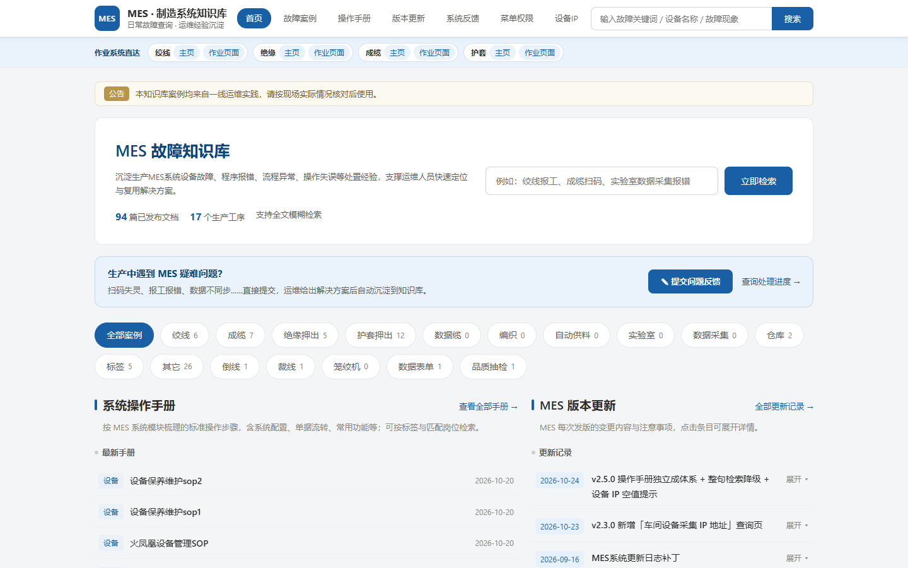
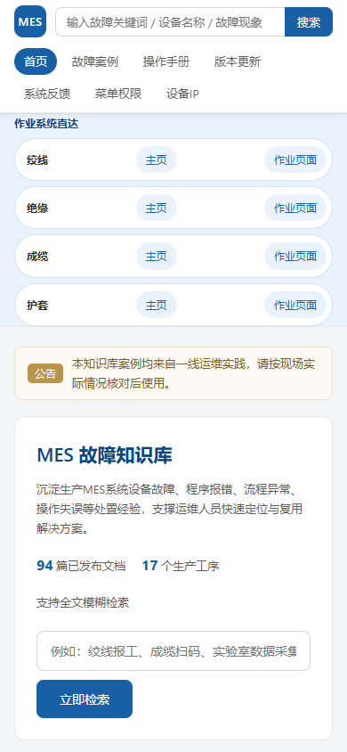
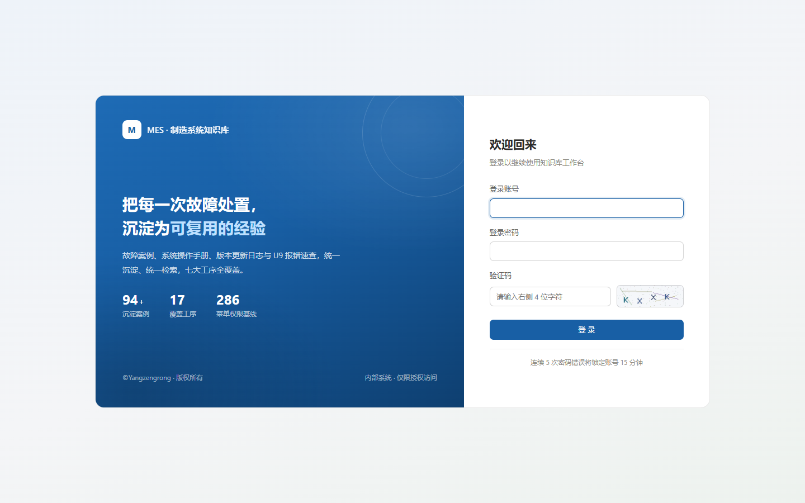
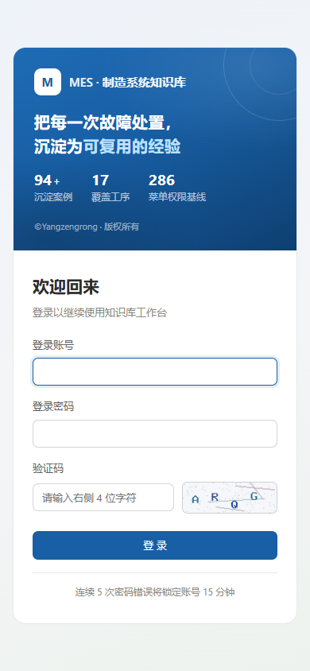

# MES系统知识库

面向生产 MES 系统运维场景的故障知识库管理系统，用于沉淀设备故障、程序报错、流程异常、操作失误等各类故障的处置经验，支撑运维人员快速检索与复用解决方案。

- **技术架构**：PHP 7.4 / 8.0 + MySQL 5.7 / 8.0（原生 PDO 预处理，无框架依赖）
- **前端**：HTML5 + CSS3 + 原生 JavaScript，无外部 CDN 依赖（适配内网部署）
- **服务器**：完全兼容 CentOS 7、Rocky Linux，支持 Nginx / Apache
- **后台入口**：`域名 + /admin`，前后端路由隔离
- **版权**：`©Yangzengrong 版权所有`（全站页脚统一展示，可在后台系统配置中修改）

---

## 界面预览

| 首页（PC 端） | 首页（手机端） |
|---|---|
|  |  |

| 后台登录（PC 端） | 后台登录（手机端） |
|---|---|
|  |  |

> 截图取自生产环境的演示数据，仅用于界面示意。

---

## 一、环境要求

| 项目 | 要求 | 说明 |
|---|---|---|
| PHP | >= 7.4（推荐 7.4 / 8.0） | 需开启 `pdo` `pdo_mysql` `mbstring` `fileinfo` `json` `session` |
| GD 扩展 | 建议安装 | 用于图形验证码；未安装时自动降级为 SVG 验证码，不影响使用 |
| MySQL | 5.7 / 8.0 | 字符集 `utf8mb4`，引擎 InnoDB |
| Web 服务器 | Nginx 1.20+ 或 Apache 2.4 | Apache 需开启 `mod_rewrite` 且 `AllowOverride All` |

安装向导会自动检测以上环境，未通过的项目会明确提示。

---

## 二、目录结构

```
mes-kb/
├─ index.php                  前台入口（路由：首页 / 检索 / 详情 / 附件）
├─ admin/                     后台入口目录（域名 + /admin）
│  ├─ _init.php               后台公共引导（含 IP 白名单校验）
│  ├─ index.php               数据看板
│  ├─ login.php / logout.php / captcha.php
│  ├─ cases.php               案例列表 / 回收站
│  ├─ case_form.php           案例新增 / 编辑表单
│  ├─ case_action.php         案例写操作统一入口
│  ├─ categories.php / category_action.php
│  ├─ users.php / user_action.php
│  ├─ attachments.php / attachment_action.php
│  ├─ logs.php / log_export.php
│  └─ settings.php / settings_action.php
├─ app/
│  ├─ bootstrap.php           应用引导（自动加载 / 会话 / 配置）
│  ├─ Core/                   基础组件
│  │  ├─ Config.php           配置容器
│  │  ├─ Database.php         PDO 封装（预处理 + 事务）
│  │  ├─ Router.php           极简路由
│  │  ├─ Request.php / View.php
│  │  ├─ Auth.php             认证与授权（三级角色）
│  │  ├─ Csrf.php             CSRF 令牌
│  │  ├─ Captcha.php          图形验证码（GD / SVG 双通道）
│  │  ├─ Firewall.php         后台 IP 白名单
│  │  ├─ Upload.php           附件上传安全校验
│  │  ├─ Logger.php           操作 / 访问 / 检索日志
│  │  ├─ Setting.php          系统配置读写
│  │  └─ Validator.php        表单校验器
│  ├─ Models/                 User / Category / CaseModel / Attachment / LogModel
│  ├─ Controllers/
│  │  ├─ Front/               HomeController / CaseController / FileController
│  │  └─ Admin/               BaseController + 8 个业务控制器
│  └─ Support/helpers.php     全局辅助函数
├─ views/
│  ├─ front/                  前台模板（layout / home / search / case / error）
│  ├─ admin/                  后台模板（layout / login / dashboard / cases / …）
│  └─ partials/pagination.php 通用分页组件
├─ static/css|js              前后台样式与脚本
├─ storage/
│  ├─ uploads/                上传附件（按年月分目录）
│  ├─ backups/                数据库备份
│  └─ logs/                   运行日志
├─ install/
│  ├─ index.php               安装向导（三步）
│  └─ schema.sql              数据库建表脚本
├─ config/config.sample.php   配置示例（安装向导会生成 config.php）
├─ .htaccess                  Apache 伪静态与安全配置
└─ nginx.conf.sample          Nginx 站点配置示例
```

---

## 三、安装部署

### 3.1 上传代码并设置权限

```bash
# 假设部署到 /www/wwwroot/mes-kb
cd /www/wwwroot/mes-kb

# 授予 Web 用户写权限（Nginx 通常为 nginx，Apache 通常为 apache）
chown -R nginx:nginx storage config
chmod -R 755 storage config
chmod 644 storage/.htaccess app/.htaccess config/.htaccess views/.htaccess
```

### 3.2 创建数据库（可选，安装向导也能自动创建）

```sql
CREATE DATABASE `mes_kb` DEFAULT CHARACTER SET utf8mb4 COLLATE utf8mb4_general_ci;
CREATE USER 'mes_kb'@'localhost' IDENTIFIED BY '请设置强密码';
GRANT ALL PRIVILEGES ON `mes_kb`.* TO 'mes_kb'@'localhost';
FLUSH PRIVILEGES;
```

### 3.3 配置 Web 服务器

**Nginx**

```bash
cp nginx.conf.sample /etc/nginx/conf.d/mes-kb.conf
vi /etc/nginx/conf.d/mes-kb.conf     # 修改 server_name / root / fastcgi_pass
nginx -t && systemctl reload nginx
```

**Apache**

```bash
# 确认 httpd.conf 中：LoadModule rewrite_module modules/mod_rewrite.so
# 且站点配置允许：<Directory /www/wwwroot/mes-kb> AllowOverride All </Directory>
systemctl restart httpd
```

### 3.4 运行安装向导

浏览器访问 `http://你的域名/install/index.php`，按三步完成：

1. **环境检测** — 自动检查 PHP 版本、扩展、目录可写性
2. **数据库与管理员配置** — 填写数据库连接信息、网站名称、超级管理员账号密码
3. **安装完成** — 自动写入 `config/config.php`、导入表结构、初始化系统配置与默认分类

> **安装完成后请立即删除 `install` 目录**，避免安装程序被再次访问。

### 3.5 验证

| 地址 | 说明 |
|---|---|
| `http://域名/` | 前台首页 |
| `http://域名/admin` | 后台登录（需求规定的统一入口） |

---

## 四、权限模型（需求 4.1）

系统采用三级角色，权限在 `app/Core/Auth.php` 的 `PERMISSIONS` 常量中集中定义：

| 角色 | 权限范围 |
|---|---|
| 超级管理员 `super_admin` | 系统全部权限：账号管理、案例审核、状态流转、彻底删除、系统配置、全部日志 |
| 运维管理员 `op_admin` | 新增/编辑**本人创建**的案例、上传与管理自有附件、查看本人操作日志；无审核权、无系统配置权 |
| 普通访客 `guest` | 仅前台检索、浏览、在线预览、下载 |

后台菜单按权限动态渲染；越权访问会返回 403 页面，异步请求返回 403 JSON。

---

## 五、案例状态机（需求 4.3）

```
                    ┌── 审核通过 ──┐
   新增 ──► 待审核 ─┤              ├──► 已发布 ──► 下架 ──► 已下架
                    └── 驳回 ──────┘        │              │
                                            │              │
                                      到期/手动标记 ──► 已过期
                                            │
                     任意状态 ──删除──► 回收站 ──恢复──► 原状态
                                            │
                              彻底删除（仅超级管理员，不可恢复）
```

- 未审核（`pending`）案例前台不可见
- 每次编辑都会写入 `case_versions` 版本快照，记录编辑人、变更说明，可回滚到任意历史版本
- 附件随案例彻底删除时同步清理磁盘文件

---

## 六、需求实现对照表

| 需求条目 | 实现位置 |
|---|---|
| 2.1 技术架构 PHP+MySQL | `app/Core/Database.php`、`install/schema.sql` |
| 2.2 服务器适配 | `nginx.conf.sample`、`.htaccess` |
| 2.3 后台 `/admin` 入口 | `admin/` 目录（独立入口，与前台路由隔离） |
| 2.4 版权规范 | `views/front/layout.php`、`views/admin/layout.php`，值取自系统配置 |
| 3.1 首页模块化展示 | `views/front/home.php`（分类板块 / 最新案例 / 热门案例 / 公告） |
| 3.2 全文模糊搜索 | `CaseModel::search()` + `views/front/search.php`，匹配标题、设备、报错代码、现象、原因、解决方案、预防措施 |
| 3.3 文件上传与管理 | `app/Core/Upload.php`、`views/admin/case_form.php` |
| 4.1 用户权限管理 | `app/Core/Auth.php`、`admin/users.php`、`Admin/UserController.php` |
| 4.2 分类管理 | `app/Models/Category.php`、`admin/categories.php`（一级/二级） |
| 4.3 案例全生命周期 | `Admin/CaseController.php`、`admin/cases.php`、`admin/case_form.php` |
| 4.4 附件精细化管理 | `app/Core/Upload.php`、`Admin/AttachmentController.php`、`Front/FileController.php` |
| 4.5 数据统计看板 | `Admin/DashboardController.php`、`views/admin/dashboard.php` |
| 4.6 系统日志记录 | `app/Core/Logger.php`、`app/Models/LogModel.php`、`admin/logs.php` |
| 4.7 安全防护 | `app/Core/Captcha.php`、`app/Core/Firewall.php`、`app/Core/Csrf.php`、`Auth::attempt()` |
| 4.8 前端用户交互 | `views/front/home.php`（热门排行/最新更新）、`views/front/case.php`（详情/浏览量/附件）、`static/js/front.js`（检索联想） |
| 4.9 系统基础配置 | `app/Core/Setting.php`、`admin/settings.php` |
| 5.1 稳定性 | PDO 预处理、事务、索引优化、日志降级兜底 |
| 5.2 兼容性 | 响应式布局，适配 Chrome / Edge / Firefox 与移动端 |
| 5.3 可拓展性 | 分层架构（Core / Models / Controllers / Views），预留评论、报修、点赞等扩展位 |
| 5.4 数据备份 | `SettingController::backup()` 纯 PHP 导出全量 SQL，支持下载与删除 |

---

## 七、常用运维操作

### 数据库备份

后台「系统配置 → 数据备份」点击**立即备份数据库**，生成 `.sql` 文件到 `storage/backups/`，可下载留存。

命令行恢复：

```bash
mysql -u mes_kb -p mes_kb < storage/backups/mes_kb_20260910_120000.sql
```

### 日志排查

```bash
tail -f storage/logs/php_error.log      # PHP 错误日志
tail -f storage/logs/fallback.log       # 数据库不可用时的降级日志
tail -f /var/log/nginx/mes-kb.error.log # Web 服务器日志
```

### 定期清理

```bash
# 清理 30 天前的备份
find storage/backups -name "*.sql" -mtime +30 -delete

# 清理 90 天前的日志表数据（在 MySQL 中执行）
# DELETE FROM access_logs WHERE created_at < DATE_SUB(NOW(), INTERVAL 90 DAY);
```

### 案例自动过期

系统会在前台访问、后台看板打开时自动将超期案例置为「已过期」。如需定时精确处理，可配置 crontab：

```bash
# 每天 00:10 触发一次（通过访问后台看板接口）
10 0 * * * curl -s -o /dev/null "http://127.0.0.1/admin/index.php"
```

---

## 八、设计说明与注意事项

**检索性能**：当前模糊检索基于 `LIKE %关键词%`，实现简单、兼容性好。当案例量增长到万级、检索出现延迟时，建议启用 MySQL 全文索引：

```sql
ALTER TABLE cases ADD FULLTEXT INDEX ft_cases_search
    (title, device, error_code, phenomenon, cause, solution, prevention) WITH PARSER ngram;
```

随后在 `CaseModel::search()` 中改用 `MATCH ... AGAINST (... IN BOOLEAN MODE)`。

**上传安全**：附件上传经过三重校验 —— 扩展名白名单、体积上限、`finfo` 真实 MIME 嗅探。扩展名与内容不符的文件会被直接拒绝。附件不落 Web 目录，一律经 `Front/FileController` 鉴权后输出，防止越权下载。

**前后台分离**：前台走 `index.php` 路由（伪静态 `/case/12`），后台走 `admin/` 下的独立 `.php` 入口。两者共用一套会话，但后台通过 `admin_user_id` 独立标识，前台无任何后台权限。

**关于 LayUI / Vue**：需求文档提到「LayUI 或 Vue 轻量化前端框架」。为适配内网部署（无法访问外网 CDN），本项目使用自研轻量样式与原生 JS，视觉风格与 LayUI 保持一致。如需替换为 LayUI，将框架包放入 `static/layui/`，在 `views/admin/layout.php` 与 `views/front/layout.php` 中引入即可，不影响后端逻辑。

---

## 开源协议

本项目以 [MIT License](LICENSE) 开源发布，版权归 **©Yangzengrong** 所有。
你可以在遵守 MIT 协议的前提下自由使用、修改与再分发；转载或衍生作品请保留版权声明与许可声明。

©Yangzengrong 版权所有
